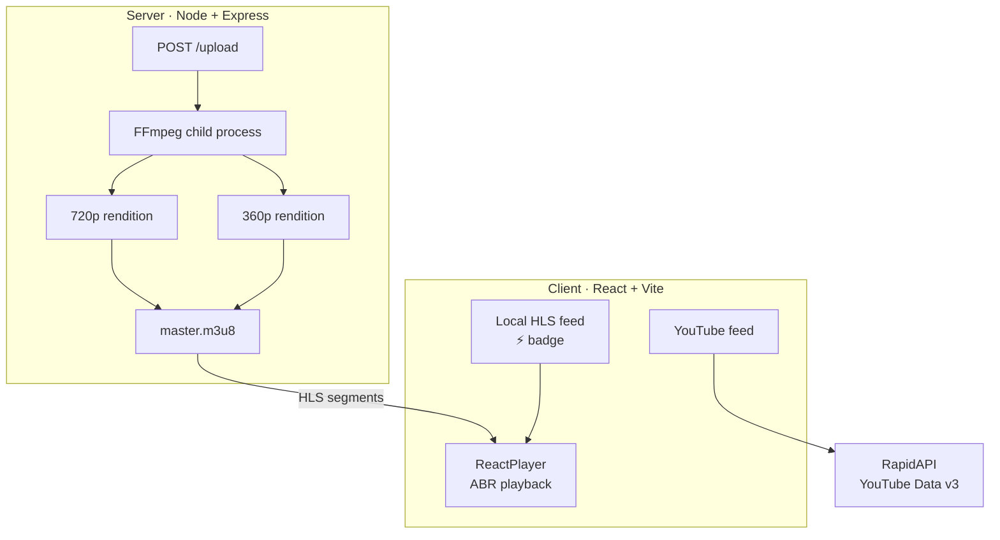
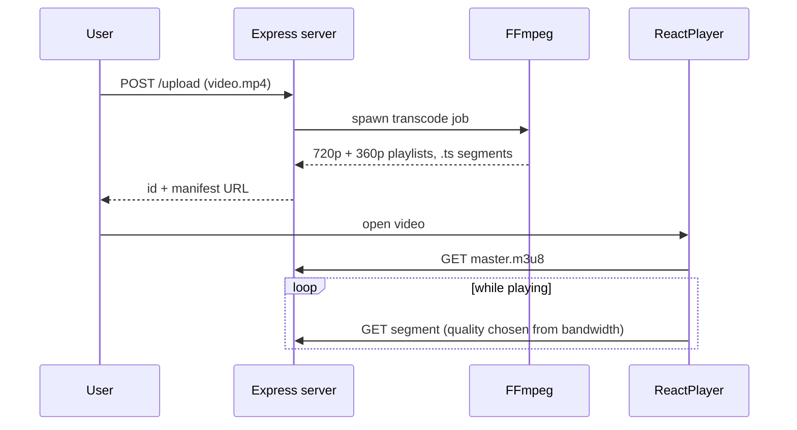

<div align="center">


# ⚡ KelvStream

**An adaptive bitrate streaming platform with a live FFmpeg HLS pipeline.**

Upload an MP4, get a multi-rendition HLS stream, and watch the player switch quality as bandwidth changes.

<br />

[](https://react.dev)
[](https://typescriptlang.org)
[](https://vitejs.dev)
[](https://nodejs.org)
[](https://ffmpeg.org)
[](https://expressjs.com)

<br />

[Demo](#demo) •
[Features](#features) •
[Architecture](#architecture) •
[Quick Start](#quick-start) •
[API](#api-reference) •
[Roadmap](#roadmap)

</div>

---

## Overview

KelvStream is a full-stack video platform that reproduces the core of how services like YouTube and Netflix deliver video:

1. **Transcode** a raw upload into multiple renditions with FFmpeg.
2. **Segment** each rendition into small HLS chunks.
3. **Publish** a master manifest so the player can pick the best quality for the viewer's connection.

The React frontend also pulls a live feed from the YouTube Data API v3, so local streams and remote videos sit side by side in one UI.

> [!NOTE]
> KelvStream is a learning and portfolio project that implements real streaming mechanics (multi-rendition encoding, segmented manifests, client-side ABR). It runs on a single Node server, so it isn't built for production traffic.

## Demo

<!-- Replace with a real GIF. Show: upload → transcode → play → throttle network → quality switch. -->
<div align="center">
  
</div>

## Features

| | Feature | Details |
|---|---|---|
| 🎞️ | **HLS transcoding** | FFmpeg encodes each upload into segmented HLS streams on the server |
| 📶 | **Adaptive bitrate** | The player switches between quality tiers as bandwidth changes |
| 🧩 | **Two renditions** | 720p HD and 360p SD, split into 6-second `.ts` segments |
| 📄 | **Master manifest** | One `master.m3u8` entry point for standards-compliant ABR |
| ▶️ | **YouTube feed** | Live video feed through RapidAPI's YouTube Data v3 wrapper |
| 🔎 | **Local HLS discovery** | Locally transcoded videos appear in the feed with a `⚡ Local HLS` badge |
| 🛠️ | **Control panel** | Built-in upload page at `localhost:5000` for testing |
| 🌌 | **Dark glass UI** | Glassmorphism, violet gradients, micro-animations, responsive layout |

## Architecture



### From upload to playback



### How adaptive bitrate works here

1. An `.mp4` is uploaded to the Express server through the control panel.
2. FFmpeg runs as a child process and encodes **two renditions**, 720p and 360p, split into 6-second `.ts` segments.
3. A **master manifest** (`master.m3u8`) is generated that references both rendition playlists.
4. The frontend detects the new upload and shows it with a `⚡ Local HLS` badge.
5. ReactPlayer loads the manifest and starts playback. If bandwidth drops or recovers, the player moves between the 720p and 360p playlists.

## Quick Start

### Prerequisites

| Tool | Version | Install |
|---|---|---|
| Node.js | 16+ | [nodejs.org](https://nodejs.org) |
| Yarn | Latest | `npm install -g yarn` |
| FFmpeg | Recent build | see below |

<details>
<summary><b>Install FFmpeg</b></summary>

```bash
# macOS
brew install ffmpeg

# Windows
winget install Gyan.FFmpeg

# Ubuntu / Debian
sudo apt update && sudo apt install ffmpeg

# Verify (all platforms)
ffmpeg -version
```

If `ffmpeg -version` isn't recognized on Windows, make sure FFmpeg's `bin` folder is on your `PATH` and restart your terminal.

</details>

### 1. Start the transcoding server

```bash
git clone https://github.com/KelvCodes/kelvstream.git
cd kelvstream/server
npm install
npm start
```

The server runs at **http://localhost:5000**.

### 2. Start the frontend

```bash
cd ../client
yarn install
```

Create `client/.env`:

```env
VITE_REACT_APP_RAPID_API_KEY=your_rapidapi_key_here
```

> [!TIP]
> Get a key by signing up at [rapidapi.com](https://rapidapi.com) and subscribing to the YouTube v3 API (a free tier is available).

```bash
yarn dev
```

Open **http://localhost:5173**.

## Usage

### Stream a local video

1. Open the control panel at **http://localhost:5000**.
2. Choose an `.mp4` and click **Upload**.
3. Watch the server terminal as FFmpeg generates segments.
4. Open **http://localhost:5173**. Your video appears at the top of the feed with a `⚡ Local HLS` badge.
5. Click to play. To see ABR in action, open DevTools → Network and throttle the connection. The player should drop to 360p and recover to 720p when you remove the throttle.

### Browse YouTube

The main feed is filled from the YouTube Data API v3 through RapidAPI, with thumbnails, titles, channel names, and view counts.

## Project Structure

<details>
<summary><b>Show the file tree</b></summary>

```text
kelvstream/
├── client/                      # React + TypeScript frontend
│   ├── src/
│   │   ├── components/
│   │   │   ├── Navbar/          # Glass top navigation
│   │   │   ├── Feed/            # Video grid + local HLS discovery
│   │   │   ├── VideoDetail/     # ReactPlayer + ABR playback
│   │   │   ├── VideoCard/       # Thumbnail cards with hover effects
│   │   │   └── Sidebar/         # Category navigation
│   │   └── utils/
│   │       └── api.js           # YouTube API service layer
│   ├── public/
│   ├── .env                     # RapidAPI key (gitignored)
│   └── vite.config.ts
│
└── server/                      # Node + Express backend
    ├── index.js                 # Entry point + transcoding logic
    ├── uploads/                 # Raw uploads (gitignored)
    └── transcoded/              # HLS output
        └── <video-id>/
            ├── master.m3u8      # ABR entry point
            ├── 720p.m3u8        # HD playlist
            ├── 360p.m3u8        # SD playlist
            └── *.ts             # 6-second segments
```

</details>

## Tech Stack

| Layer | Technology |
|---|---|
| UI | React 18, TypeScript, Vite |
| Playback | ReactPlayer (HLS with ABR) |
| Styling | Custom CSS design system, no component framework |
| Server | Node.js, Express |
| Uploads | Multer |
| Transcoding | FFmpeg via child process |
| Remote data | RapidAPI YouTube Data v3 |

## Design System

| Token | Value | Usage |
|---|---|---|
| `--bg-primary` | `#0a0a0f` | Page background |
| `--accent-violet` | `#7c3aed` | Primary actions, gradients, borders |
| `--accent-pink` | `#c084fc` | Highlights, hover states, glow |
| `--glass-bg` | `rgba(255,255,255,0.05)` | Glass card backgrounds |
| `--blur` | `blur(20px)` | Navbar and sidebar frosted effect |

**Micro-interactions:** cards lift 4px with a violet glow on hover, the play overlay fades in over a radial mask, and a pulsing loader runs during transcoding.

## API Reference

### `POST /upload`

Accepts a multipart upload and starts FFmpeg transcoding.

```http
Content-Type: multipart/form-data
Body: file (*.mp4)
```

```json
{
  "id": "vid_1718000000000",
  "status": "transcoding",
  "manifest": "/transcoded/vid_1718000000000/master.m3u8"
}
```

### `GET /transcoded/:id/master.m3u8`

Returns the HLS master manifest.

```m3u8
#EXTM3U
#EXT-X-VERSION:3
#EXT-X-STREAM-INF:BANDWIDTH=2800000,RESOLUTION=1280x720
720p.m3u8
#EXT-X-STREAM-INF:BANDWIDTH=800000,RESOLUTION=640x360
360p.m3u8
```

### `GET /transcoded/:id/*.ts`

Serves individual media segments.

## Troubleshooting

| Problem | Fix |
|---|---|
| `ffmpeg: command not found` | Install FFmpeg and make sure it's on your `PATH` |
| Upload works but the video never appears | Check the server terminal for FFmpeg errors, then refresh the feed |
| YouTube feed is empty | Check your RapidAPI key and subscription, and that the `.env` variable name matches |
| Video won't play from another device | Use your machine's LAN IP instead of `localhost`, and allow the ports through your firewall |

## Roadmap

- [x] FFmpeg HLS pipeline (720p + 360p)
- [x] Master manifest with ABR
- [x] Local HLS discovery in the feed
- [x] YouTube Data API feed
- [ ] 1080p rendition and configurable ladders
- [ ] Transcoding progress via WebSocket or SSE
- [ ] Job queue (BullMQ) so uploads don't block each other
- [ ] Thumbnail and preview generation
- [ ] Manual quality selector in the player
- [ ] Upload validation and size limits
- [ ] Docker and docker-compose setup

## Contributing

```bash
git checkout -b feat/your-feature
git commit -m "feat: describe your change"
git push origin feat/your-feature
```

Then open a Pull Request.

## License

Released under the [MIT License](./LICENSE).

<div align="center">

<br />

Built with precision. Streamed with purpose. ⚡

**KelvStream** · [KelvCodes](https://github.com/KelvCodes)

</div>
 
